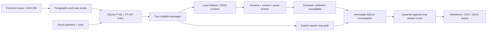

# F2 architecture and evidence contract



## Component boundaries

| Component | Responsibility |
|---|---|
| React / TypeScript | Case queue, question/settings draft, timeline, citation inspector, review form, history and recorded evaluation |
| FastAPI / Pydantic | Strict request types, bounded fields, fixed model/prompt choices and single-origin static serving |
| retrieval.py | Corpus integrity, paragraph IDs, case/procedure scope, parameterized FTS5 and TF-IDF ranking |
| model.py | Fixed localhost model endpoint, CPU options, prompt/schema provenance and output checks |
| service.py | Investigation snapshot, runtime/configuration identity and a template-based report |
| store.py | Local SQLite persistence; immutable investigation JSON and append-only review rows |
| evaluate.py | Separate gold labels, development comparison, frozen selection and held-out scoring |

The source corpus is checksum-verified at startup. The index contains all documents; eligibility limits returned evidence to the requested case or a shared procedure. FTS IDF and TF-IDF vocabulary are fitted on corpus text, never on evaluation questions/labels. There is no neural embedding model, vector database server or external search service.

## Retrieval definition

1. Tokenize the question into at most 24 alphanumeric, non-stopword terms. Raw FTS operators and SQL do not pass through.
2. Execute a parameterized FTS5 query and BM25 rank. Apply the requested case/shared-procedure scope.
3. Calculate cosine similarity against L2-normalized TF-IDF word/unigram-bigram vectors (`sublinear_tf=True`).
4. Require a lexical hit and similarity at least **0.06**, then combine ranks as `1/(60 + lexical_rank) + 1/(60 + tfidf_rank)`.
5. Return at most **four** passages, breaking ties deterministically by scores and ID.

Similarity and rank fusion are retrieval diagnostics, not probabilities or answer confidence. A missing hit does not prove the corresponding event never occurred. The corpus is deliberately small; no large-scale retrieval claim is made.

## Local generation and checks

The request contains the prompt version, the question, and retrieved IDs/kinds/text. It does not contain authored case flags, gold expected answers or evaluation labels. Ollama uses an installed allowlisted model on **127.0.0.1:11434**, with seed 42, temperature 0, four threads, `num_gpu=0`, 4,096 context tokens and a 260-token output limit. A request has a 40-second model timeout. Models are never downloaded inside an investigation.

The generated schema has only:

```json
{
  "status": "supported | insufficient | conflict",
  "evidence": [{"passage_id": "SOURCE:p1", "quote": "An exact source excerpt"}]
}
```

Evidence has at most three items. Supported requires at least one quote; insufficient requires none; conflict requires at least two distinct passage IDs. Unknown fields, duplicate citations, non-retrieved IDs and quotes absent from their cited body are rejected. Whitespace is normalized only for quote matching. No free-form explanation is accepted as an answer.

**These are mechanical checks.** They do not establish whether two records truly conflict, whether an excerpt answers the question, whether an estimate was confirmed, or whether a fictional procedure is suitable for real operations. Held-out failures demonstrate that a wrong stance can accompany valid quotations. The app explicitly exposes this limit.

| State | Meaning |
|---|---|
| checked | The schema and source/quote rules passed. This also includes a structurally valid insufficient response with no quotes. |
| withheld | The model completed but its output failed schema/source/quote checks. Raw JSON stays in the technical trace, not the accepted draft. |
| unavailable | The selected local model was absent or a request failed/timed out. Retrieved evidence remains usable. |
| not_requested | Explicit search-only mode; no generation call was made. This is not a generative RAG result. |

## Snapshots and review

Each investigation gets a UUID and UTC creation time. Its immutable JSON includes the request, case and scoped source snapshot, retrieved passages/ranks, raw response, accepted draft or failure, model digest, prompt/schema hashes, engine hash, corpus hash, settings and measured durations. The stored runtime records Python, scikit-learn and FastAPI versions; complete tested Python versions are pinned in constraints.txt.

The browser's editable question/settings remain separate from the saved investigation. A change notice explains that old results and exports refer to the saved request. Review notes append to a second table and never rewrite model output. A Reviewed disposition is bookkeeping, not a model-quality certificate. No external email, order, engineering approval or release is sent.

SQLite operations use parameterized SQL and short-lived connections under a process lock. One local API process is the intended scope; multi-user authorization, distributed workers and enterprise governance are not implemented. No arbitrary file/SQL/model-endpoint input is accepted by the API.

## Evaluation protocol

The final development comparison makes 24 actual local calls: two model sizes × two prompt versions × six development questions. Selection maximizes strict task checks, then value-fragment checks, then accepted-output count; ties prefer 1.5B and v2. The release/protocol files record configuration, code/corpus/prompt hashes and a freeze timestamp before the held-out stage.

The held-out stage makes 18 calls on six separate cases in the fixed indexed corpus. It checks the frozen engine, corpus, selected prompt and evaluation-script fingerprints before running. Each raw response, context, expected source set and per-question score is saved. No target labels enter the generation context. This is a small authored fixture experiment, not a representative real-world accuracy benchmark.

- **Required-source hit:** every gold passage is in the top four, denominator 12 answerable questions.
- **Accepted value-fragment check:** all annotated value strings occur in accepted quote text, denominator 12. This alone is not the full task check.
- **Correct abstention:** accepted insufficient stance on an unavailable-information question, denominator six. Withheld drafts are not counted as correct model refusals.
- **Exact task check:** expected stance, exact selected passage-ID set, and required value fragments all match, denominator 18.
- **Checked output:** schema/source checks pass, including valid empty refusals. It is deliberately reported separately from task correctness.

Exact source sets can penalize other reasonable evidence choices. Latency includes retrieval, local model status/inference and checking, but excludes setup/model downloads and database persistence. Warm/cold model loading and run order affect timings. No statistical significance or general model ranking is claimed.

## Local delivery

setup_project.py creates a local ignored environment, installs constrained Python requirements, runs npm ci and builds the React assets. launch.py starts one localhost server for interface/API on port 8532. It reuses an existing Ollama service, can start an installed runtime or the optional portfolio runtime cache, and never pulls weights. A service started by the launcher is owned and terminated by that launcher; an existing Ollama service is left alone.

Without Ollama/weights, browsing, retrieval, notes and exports remain available with explicit generation-unavailable/search-only labels. API schema is local JSON at /openapi.json. Package installation requires initial internet access; normal use needs no paid account, cloud inference or external data service.
