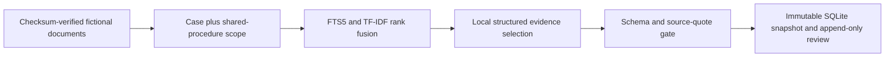
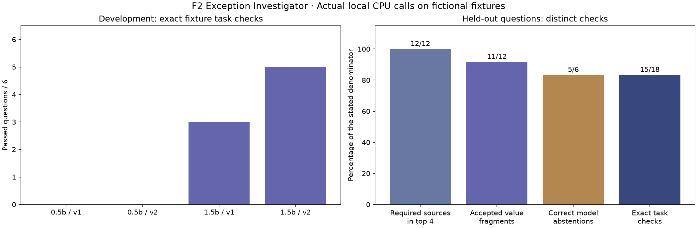

# Supply Chain Exception Investigator — F2

A local extractive-RAG casework system with case-scoped hybrid lexical retrieval, schema-constrained Ollama evidence selection, verbatim citation checks, persistent investigation snapshots and separate analyst review notes.

> Evidence boundary: every case and procedure is fictional. Mechanical quote/schema checks do not establish semantic correctness, and retrieval-only output is explicitly distinguished from generated evidence selection.

## Contents

- [Overview](#overview)
- [Dataset and data contract](#dataset-and-data-contract)
- [Architecture and components](#architecture-and-components)
- [Processing pipeline](#processing-pipeline)
- [Configuration and metric definitions](#configuration-and-metric-definitions)
- [Recorded results and evidence](#recorded-results-and-evidence)
- [Interpretation and operational use](#interpretation-and-operational-use)
- [Running locally](#running-locally)
- [API reference](#api-reference)
- [Validation and reproducibility](#validation-and-reproducibility)
- [Project structure](#project-structure)
- [Technology stack](#technology-stack)
- [Limitations and next steps](#limitations-and-next-steps)
- [Further technical documentation](#further-technical-documentation)

## Overview

**What do the available records establish about a supply-chain exception, what remains uncertain, and which documented procedure applies?**

The six-section React interface provides a **case inbox, investigation workspace, evidence library, draft history, evaluation lab and method/audit page**. Users inspect a timeline, ask a bounded question, click citations to highlight source text, append an analyst note and export the saved investigation. No message, order, approval or shipment update is sent.

## Dataset and data contract

**All data is fictional.** This repository contains eight authored exception cases, 24 case records and seven shared procedure documents: **31 source documents / 31 paragraphs**. The scenarios cover reported delay, damage, count discrepancies, missing temperature records, unsigned delivery proof, conflicting ETAs, proposed substitutions and missing border paperwork.

There is no suitable public company case file containing this complete evidence/review schema, so the teaching fixture is explicitly authored rather than represented as real operations. `prepare_data.py` uses **seed 42** for selected quantities and evaluation-question order; the narrative templates, IDs, dates and labels are deliberately specified. No real customer/company data, paid dataset, login or private procedure is required.

| Field / asset | Meaning |
|---|---|
| Case ID, category, severity, summary, authored_flag | Fictional case metadata; priority/flags are not model predictions |
| Document ID, case_id, kind, recorded_at, text | Stable source identity, eligibility scope and original fictional text |
| `SOURCE:p1` | Paragraph identifier used for retrieval and citations |
| `data/prompts/v1.txt`, `v2.txt` | Concise baseline versus explicit evidence-boundary instructions |
| Six development questions | Two cases, used to compare configurations |
| Eighteen held-out questions | Six separate cases in the indexed corpus; 12 answerable checks and six unavailable-information questions |
| Gold source IDs / value fragments / stance | Offline scoring annotations; never passed to the model or fitted into the retriever |

The [corpus](data/corpus.json), [manifest](data/manifest.json), [provenance](data/SOURCE.md) and [evaluation questions](data/evaluation_questions.json) are bundled. Final corpus SHA-256: `c1345f9f7bd7b1516b0017100897ffd7a1da014589ed367422f8fc4daa06ca9f`. Source documents for held-out questions are available in the index; the held-out claim concerns configuration selection on separate case questions, not generalization to unseen documents.

## Architecture and components



| Component | Entry points or assets | Responsibility |
|---|---|---|
| [prepare_data.py](prepare_data.py) | Corpus and evaluation fixtures | Create authored cases/procedures, checksums and distinct development/held-out questions. |
| [backend/retrieval.py](backend/retrieval.py) | Retriever | Build FTS5 and TF-IDF indexes and return case-scoped passages. |
| [backend/contracts.py](backend/contracts.py) | Request, draft and review schemas | Bound requests and enforce stance/evidence consistency. |
| [backend/model.py](backend/model.py) | Local generation and source checks | Call the installed model and reject unknown citations or unsupported quoted text. |
| [backend/service.py](backend/service.py) | Investigation orchestration | Combine retrieval, inference, checks and measured trace metadata. |
| [backend/store.py](backend/store.py) | SQLite evidence history | Persist snapshots and separate append-only notes. |
| [evaluate.py](evaluate.py) | Frozen comparison protocol | Compare development configurations and score the selected held-out run. |
| [frontend/src/App.tsx](frontend/src/App.tsx) | Casework interface | Navigate cases, inspect citations, reopen history and export saved evidence. |

## Processing pipeline

1. Verify the fictional corpus checksum and split documents into paragraphs with stable source IDs. Preserve case/procedure scope and original text.
2. Rank eligible passages with **SQLite FTS5/BM25 and TF-IDF word-vector cosine similarity**. Combine ranks using reciprocal-rank fusion with k=60. Return at most four passages, requiring a lexical hit and TF-IDF similarity of at least 0.06. These are word-matching diagnostics, not confidence probabilities or neural embeddings.
3. In local-AI mode, send only the question and retrieved passage IDs/kinds/text to an installed **Ollama/Qwen** model. Use CPU, seed 42, temperature 0, four threads, 4,096 context tokens and a 260-token output limit. No model is downloaded during a request.
4. Constrain generation to a stance—supported, insufficient or conflict—and up to three exact cited quotes. Insufficient must have no quotes; conflict requires at least two distinct passage IDs.
5. Validate schema, citation scope, quote membership and duplicates. Withhold invalid output. **Passing those checks does not prove relevance, a correct stance or factual truth.** No unrestricted model prose is accepted as business advice.
6. Save an immutable SQLite investigation snapshot, including raw output, sources, settings, hashes, model digest and measured duration. Keep editable browser inputs separate from saved evidence. Analyst notes append separately and do not alter the model output.
7. Compare two model sizes and two prompt versions on six development questions. Select by exact task checks, then field/output checks, with declared tie-breaks. Freeze the selection before the held-out stage and preserve all actual calls.
8. Evaluate 18 questions from six other cases using the frozen configuration. Report retrieval, value-fragment, abstention, output-validation and full task checks separately. Keep raw failures available for inspection.

[Architecture and contracts](ARCHITECTURE.md) explain each component. SQLite FTS5 and Ollama's schema-constrained output capabilities follow their [official SQLite documentation](https://www.sqlite.org/fts5.html) and [Ollama documentation](https://docs.ollama.com/capabilities/structured-outputs). The model-backed path is **extractive RAG**; explicit search-only mode is retrieval without a generated answer.

## Configuration and metric definitions

### Retrieval and output contracts

| Setting | Implemented value |
|---|---|
| Eligibility scope | Selected case documents plus global procedures |
| Text representation | English-stopword TF-IDF, unigrams/bigrams, sublinear term frequency |
| Lexical index | SQLite FTS5 using `porter unicode61` and BM25 ordering |
| Fusion | Reciprocal-rank sum using denominator constant 60 |
| Passage acceptance | Lexical hit plus TF-IDF similarity at least 0.06 |
| Retrieval limit | Up to four passages |
| Generation | CPU, four threads, temperature 0, seed 42, context 4,096, output limit 260 |
| Evidence | At most three quoted passages; source membership and whitespace-normalized substring checked |
| Stance | `supported`, `insufficient` or `conflict` |

Supported requires evidence; insufficient requires none; conflict requires at least two distinct passage IDs. Generic output states include `checked`, `withheld`, `unavailable` and `not_requested`. A `checked` empty abstention is not an answered question. Search-only mode makes no model call. Gold labels never enter generation context; all source documents, including held-out-case documents, are available to the index.

The strict task check requires the expected stance, exact annotated source-ID set and required value fragments. Retrieval success, quote/value checks, abstention and generic validation are reported separately, with their own denominators.

## Recorded results and evidence

Actual local CPU calls selected **Qwen2.5 1.5B / prompt v2**. The recorded model digest was `65ec06548149b04c096a120e4a6da9d4017ea809c91734ea5631e89f96ddc57b`, using Ollama **0.40.11**. That digest/runtime matched across the selected development calls and all held-out calls.

| Final development configuration | Exact task checks | Output checks passed |
|---|---:|---:|
| Qwen2.5 0.5B / v1 | 0/6 | 4/6 |
| Qwen2.5 0.5B / v2 | 0/6 | 5/6 |
| Qwen2.5 1.5B / v1 | 3/6 | 6/6 |
| **Qwen2.5 1.5B / v2** | **5/6** | **6/6** |

This is a tiny fixture comparison, not a universal model ranking. An earlier development round was retained after correcting fictional record-ingestion timestamps before held-out evaluation; see [source provenance](data/SOURCE.md).

| Frozen held-out check | Actual result |
|---|---:|
| Exact stance + exact source-ID set + required value fragments | **15/18 (83.33%)** |
| Every required source present in top four | **12/12 answerable questions** |
| Required value fragments in accepted quotes | **11/12 answerable questions** |
| Correct model abstention | **5/6 unavailable-information questions** |
| Schema/source checks passed | **17/18**, including valid empty abstentions |
| Drafts withheld by the gate | **1** |
| Answered/conflict stance on an unanswerable item | **1** |
| Completed held-out local calls | **18/18** |
| Median end-to-end investigation time | **2.23 seconds** |
| Mean end-to-end investigation time | **2.25 seconds** |

Timing includes retrieval, local model status/inference and checking. It excludes initial installation/model download and database persistence. Model loading, hardware and run order affect latency. The final development/held-out sequence contains **42 completed calls**; the earlier 24-call development round is archived separately.



**The three failed held-out checks are retained:**

- **TEST-01, count discrepancy:** the model correctly quoted the dispatch count of 100 and receiving count of 80, but chose supported instead of conflict. Mechanical checks passed; the stance was wrong.
- **TEST-10, ETA conflict:** the model returned conflict with no evidence, violating the output contract. The draft was withheld and was not counted as a correct abstention.
- **TEST-09, unconfirmed recipient:** the model chose conflict instead of insufficient and cited real case/procedure text. No recipient was invented, but the stance/source selection failed the intended task.

These results demonstrate why **17/18 accepted outputs is not 17/18 correct answers**. The 15/18 figure is a narrow fixture check, not general operational accuracy or a guarantee of safety.

[Application screenshot](outputs/investigation.png)

Saved evidence: [evaluation summary](outputs/evaluation_summary.json), [complete held-out outputs](outputs/heldout_results.json), [final development outputs](outputs/development_results.json), [development summary](outputs/development_summary.json), [frozen protocol](outputs/evaluation_protocol.json), [selected release](data/release.json), [actual browser-demo snapshot and note](outputs/demo_investigation.json), [exported demo brief](outputs/demo_case_brief.md) and [verification record](outputs/verification.md). Screenshots also show the [inbox](outputs/inbox.png), [source library](outputs/library.png) and [evaluation lab](outputs/evaluation_lab.png).

## Interpretation and operational use

- **Inspect interpretation as well as citations:** the count-discrepancy failure used genuine, relevant excerpts but the wrong stance. Correct quotations alone cannot adjudicate a case.
- **Keep missing information explicit:** five of six unavailable-information questions received the expected model abstention. The remaining case needs human review; a valid conflict response did not establish a confirmed recipient.
- **Keep the fallback honest:** search-only mode makes zero model calls and preserves the retrieved evidence. It supports continued case review, while clearly avoiding a generated-answer claim.

## Running locally

The three setup/launch commands below start at the repository root.

Prerequisites: **Python 3.12+, a Vite-compatible Node.js installation, and SQLite with FTS5 support**. Verified here with Python **3.12.14**, Node **25.2.0**, npm **11.19.0** and SQLite **3.53.1**. Ollama and a downloaded supported model are optional for browsing/search, and required for generation.

```powershell
cd projects/f2-supply-chain-exception-investigator
python setup_project.py
python launch.py
```

Open **http://127.0.0.1:8532**, select **Open delay case**, then **Run investigation**. Setup creates this project's ignored `.venv`, installs constrained Python packages and builds the locked React dependencies. It is normally one-time; later use only `python launch.py`. Ctrl+C stops the app. `python launch.py --port 8533` selects another local port if needed.

The launcher reuses an existing localhost Ollama service, can start an installed runtime, or optionally recognizes an optional ignored portable runtime cache. It never pulls model weights. On another machine, install Ollama and obtain `qwen2.5:1.5b` separately if local generation is wanted. Without a suitable model, retrieval remains available and the app labels the result unavailable/search-only. No other project is imported. There are no keys, paid services, GPU requirement or cloud inference calls.

Optional developer commands, separate from launching: `.venv/Scripts/python.exe -m unittest discover -s tests -v` runs mechanical/API checks; `.venv/Scripts/python.exe evaluate.py --stage development` compares configurations; `.venv/Scripts/python.exe evaluate.py --stage heldout` runs the frozen held-out stage. The optional four-setting comparison requires both local model sizes. Preserve old outputs and use new independent questions for future tuning rather than treating reused held-out questions as unseen.

`prepare_data.py` rebuilds the deterministic fixture. Restart the server after changes to code/data; recorded evaluations describe their saved configuration. Local histories/notes live in ignored `runtime/investigations.sqlite3`. The API schema is at `/openapi.json`; exports are generated locally. [PROJECT_FILES.md](PROJECT_FILES.md) contains the folder structure and individual copyable source blocks.

## API reference

The interface and API share one localhost origin. Route declarations are implemented in [backend/api.py](backend/api.py); `/openapi.json` exposes the generated schemas.

| Method | Route | Handler |
|---|---|---|
| GET | `/api/health` | `health` |
| GET | `/api/catalog` | `catalog` |
| GET | `/api/model-status` | `model_status` |
| POST | `/api/investigations` | `create` |
| GET | `/api/investigations` | `history` |
| GET | `/api/investigations/{run_id}` | `detail` |
| POST | `/api/investigations/{run_id}/reviews` | `add_review` |
| GET | `/api/investigations/{run_id}/export/{kind}` | `export` |
| GET | `/api/evaluation` | `evaluation` |

### Investigation request

Example body for `POST /api/investigations`:

```json
{
  "case_id": "EX-1042",
  "question": "What delay reason did the supplier report?",
  "mode": "local_ai",
  "model": "qwen2.5:1.5b",
  "prompt_version": "v2"
}
```

Questions must contain 5-400 characters and reference a known case. Supported modes are `local_ai` and `search_only`; supported models are the two configured Qwen sizes, and prompts are `v1`/`v2`. Review notes use `reviewed` or `needs_follow_up` dispositions and contain 1-1,200 characters. Unknown fields and invalid schemas return 422; unknown cases/investigation UUIDs return 404. The export kind is `json`, `md` or `csv`.

The server is intended for a trusted single-user local environment. These routes do not constitute an authenticated public deployment. Saved output identifiers refer to immutable analytical snapshots rather than editable browser drafts.

## Validation and reproducibility

The automated suite contains **11 tests**. It checks the following implementation boundaries:

Test implementation: [tests/test_investigator.py](tests/test_investigator.py).

- Scoped retrieval never exposes other cases.
- Known development fact and policy are retrieved.
- Empty and fts operator queries are safe.
- Valid verbatim selection.
- Invented quote and unknown citation are withheld.
- Invalid schema duplicate and false conflict rejected.
- Empty evidence refusal remains an explicit model stance.
- Unavailable model is not a generated answer.
- Search only never calls model or reads evaluation labels.
- Model receives only question and scoped passages.
- Api persistence review history and exports.

From the project directory, run:

```powershell
.venv/Scripts/python.exe -m unittest discover -s tests -v
```

Recorded execution and any browser-review evidence is retained in [outputs/verification.md](outputs/verification.md). Reported figures correspond to saved execution artifacts; running a report generator can overwrite its generated outputs. Package requirements, source checksums and fixed parameters define the reproducibility boundary; elapsed times and some model/solver outputs can vary across environments. The setup script also performs TypeScript checking and a production frontend build using the npm lockfile.

## Project structure

```text
f2-supply-chain-exception-investigator/
  ARCHITECTURE.md
  constraints.txt
  evaluate.py
  INTERVIEW_GUIDE.md
  launch.py
  prepare_data.py
  PROJECT_FILES.md
  README.md
  requirements.txt
  setup_project.py
  start_local.py
  backend/
    __init__.py
    api.py
    contracts.py
    model.py
    retrieval.py
    service.py
    store.py
  frontend/
    package.json
    package-lock.json
    tsconfig.json
    index.html
    src/
      App.tsx
      main.tsx
      styles.css
      types.ts
      vite-env.d.ts
      workbench.css
  tests/
    __init__.py
    test_investigator.py
  data/
    Bundled inputs, provenance and prepared data
  outputs/
    Recorded metrics, audit files, tables and figures
```

Generated environments, database files, model artifacts and compiled assets follow the project's [.gitignore](.gitignore). The [copyable source bundle](PROJECT_FILES.md) mirrors the README and contains individual file blocks.

## Technology stack

React **19.3.1**, TypeScript **7.0.2**, Vite **8.3.5**, Lucide React **1.61.0**, custom CSS, Python, FastAPI, Pydantic, SQLite/FTS5, scikit-learn TF-IDF, NumPy, local Ollama/Qwen, standard-library HTTP/JSON/hash utilities, unittest and matplotlib. No neural-embedding model, vector-database server, fine-tuning or commercial API is used. Requirements, transitive constraints and npm lockfile record tested packages.

## Limitations and next steps

- The corpus and procedures are fictional and small. Results do not validate real supplier investigations, customs rules, quality release or actual shipment outcomes.
- The index includes all case documents; held-out case questions are not a test on new unseen documents or organizations. Exact gold source sets and value strings can penalize other reasonable excerpts.
- There are only six development and 18 held-out questions. No statistical significance, representative accuracy, broad model ranking or independent external benchmark is established.
- Source checks are mechanical. A valid source quote can accompany an incorrect stance, irrelevant evidence or an unsupported interpretation. The actual failures demonstrate this.
- Retrieval is lexical word-vector search with a fixed threshold. It can miss paraphrases, and top-four selection may omit relevant context in a larger corpus.
- Generation is deliberately extractive. It selects quotes and stance rather than performing unrestricted multi-step research, arithmetic, causal diagnosis, approvals or autonomous actions.
- Temperature, recipient, cost and performance values are not inferred when absent. Missing information and disagreement need actual source clarification; analyst notes are not substitutes for verified evidence.
- Repeated questions can vary with model/runtime versions despite fixed options. Timing depends on loading, CPU and call order. Weights are not bundled and model installation is an optional external prerequisite.
- This is a single-user localhost app with no authentication or case-level permissions for real private data. It is not a deployed enterprise service. Desktop browser flows were verified; no mobile-device benchmark or accessibility certification is claimed.
- The supplied evaluation is a saved measurement, not a live accuracy estimate. Future improvements should use independently authored cases/questions before further prompt/retrieval tuning, with broader semantic review and real authorized documents where appropriate.

## Further technical documentation

- [Dataset attribution, licensing and source transformations](data/SOURCE.md)
- [Pinned Python dependencies](requirements.txt)
- [Recorded transitive dependency constraints](constraints.txt)
- [Frontend dependency lockfile](frontend/package-lock.json)
- [Detailed architecture, contracts and implementation boundaries](ARCHITECTURE.md)
- [Recorded execution and verification evidence](outputs/verification.md)
- [Folder structure and individually copyable source files](PROJECT_FILES.md)

[Back to contents](#contents)
